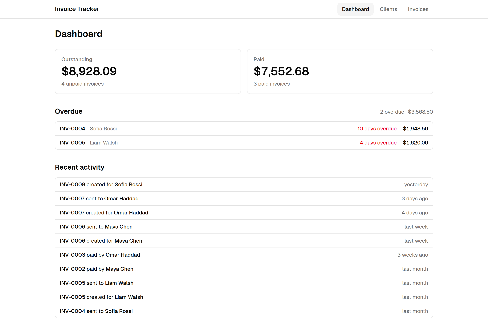

# Freelance Invoicing & Client Tracker

[](https://github.com/Rh96/freelance_invoicing_and_client_tracker/actions/workflows/ci.yml)

A web app for a solo freelancer: keep a client list, build invoices with line items and tax, and see at a glance who owes you money and who is late.

**Live demo:** <https://freelance-invoicing-and-client-trac.vercel.app/>



> **Try it.** The demo opens with fictional clients and invoices, saved in your browser only (nothing is sent anywhere). Change anything you like; **Reset demo data** in the footer restores the starting data. To see the error states, add `?simulateErrors=writes` (every save fails, so you can watch an optimistic update roll back) or `?simulateErrors=all` (every load fails) to the URL; `?simulateErrors=off` turns it off again.

## What it does

- **Clients:** list with search, create, edit, and archive (archived clients are hidden but keep their invoices).
- **Invoices:** line items with live totals, one tax rate, automatic numbering (`INV-0001`), and a Draft → Sent → Paid lifecycle; Paid can be undone. Only drafts can be edited. A print view saves a one-page PDF through the browser.
- **Dashboard:** outstanding versus paid totals, overdue invoices (most overdue first), and a recent activity feed.

|                                              Invoice form                                               |                                                   Invoice detail                                                    |
| :-----------------------------------------------------------------------------------------------------: | :-----------------------------------------------------------------------------------------------------------------: |
|  |  |
|                                             **Print view**                                              |                                                **Phone, dark mode**                                                 |
|                                 |                               |

Out of scope for v1, on purpose: real authentication, payments, sending email, multiple currencies and recurring invoices.

## What it demonstrates

| Area                       | How it's used here                                                                                                                                                                                           |
| -------------------------- | ------------------------------------------------------------------------------------------------------------------------------------------------------------------------------------------------------------ |
| Next.js App Router (16)    | Thin route files in [`src/app`](src/app), Cache Components (partial prerendering) with dynamic params read inside `<Suspense>`, route-level error boundaries, typed routes                                   |
| TypeScript (strict)        | `strict` plus `noUncheckedIndexedAccess`, no `any`; Zod schemas are the single source of the domain types ([`src/domain`](src/domain))                                                                       |
| TanStack Query             | Query-key factories, cache updates after saves, and **optimistic status changes with rollback** ([`invoices/mutations.ts`](src/features/invoices/mutations.ts))                                              |
| Zustand                    | UI state only: search, status filter, one-time messages ([`src/stores`](src/stores))                                                                                                                         |
| Forms and validation       | React Hook Form + Zod: a dynamic line-item array, live totals, cross-field date checks, errors from the data layer mapped back onto fields ([`invoice-form.tsx`](src/features/invoices/invoice-form.tsx))    |
| Tailwind and accessibility | Tailwind 4 + shadcn/ui (Radix), dark mode from the OS, print CSS; skip link, labelled fields, focus management, live regions, status shown as text and not only colour                                       |
| Testing                    | Vitest + React Testing Library against a real in-memory repository (no mocks of our own code); Playwright end-to-end tests, including axe accessibility scans and a keyboard-only walkthrough ([`e2e`](e2e)) |
| CI/CD                      | GitHub Actions runs lint, type check, unit tests and the production build, then the end-to-end suite against that build; Vercel deploys every PR as a preview and `main` to production                       |

## Run it locally

Requires Node 22+.

```bash
npm install
npm run dev        # http://localhost:3000
```

| Script                 | What it does                                                                      |
| ---------------------- | --------------------------------------------------------------------------------- |
| `npm run dev`          | Development server                                                                |
| `npm run build`        | Production build                                                                  |
| `npm test`             | Unit and component tests (single run); `npm run test:watch` to watch              |
| `npm run e2e`          | End-to-end tests against the production build (run `npm run build` first)         |
| `npm run lint`         | ESLint                                                                            |
| `npm run typecheck`    | Generate Next route types, then `tsc`                                             |
| `npm run format:check` | Prettier check; `npm run format` to fix                                           |
| `npm run screenshots`  | Regenerate the README images in `.github/screenshots` (run `npm run build` first) |

The end-to-end tests use your installed Google Chrome, so there's no browser download.
