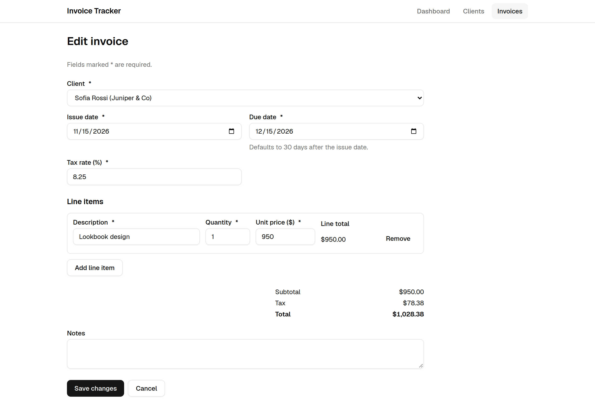
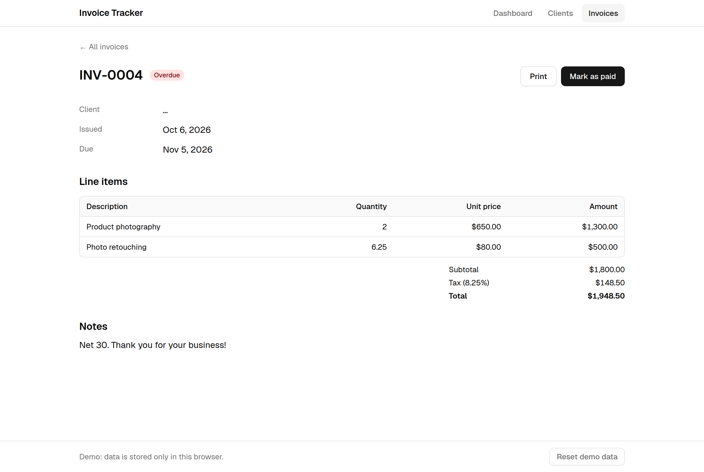
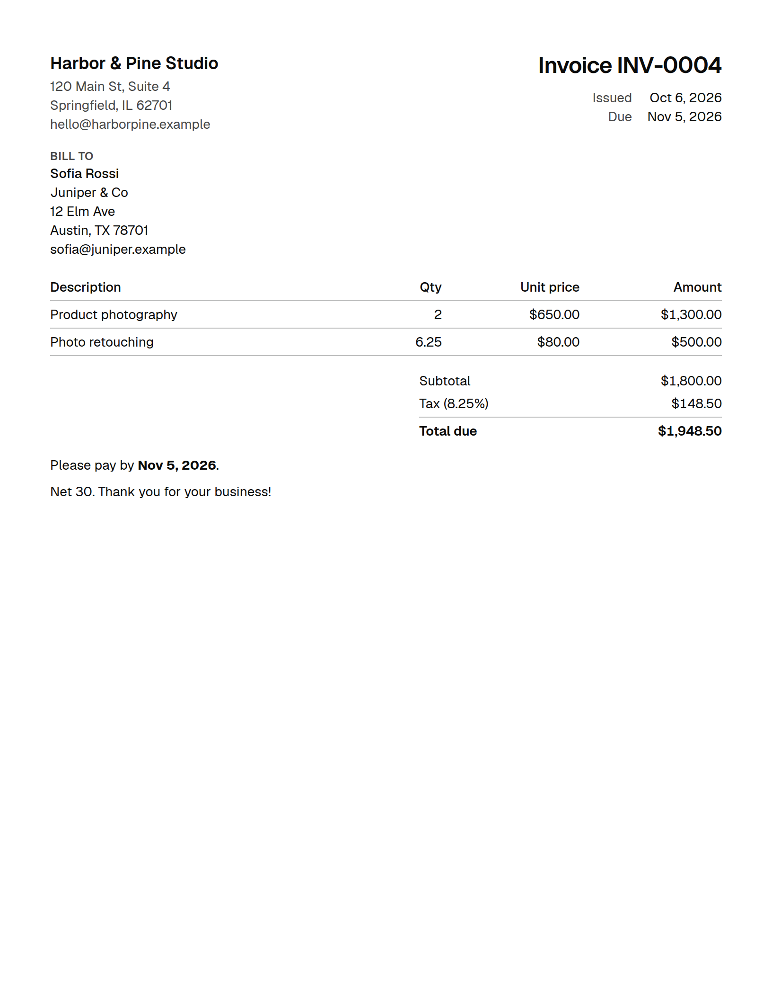
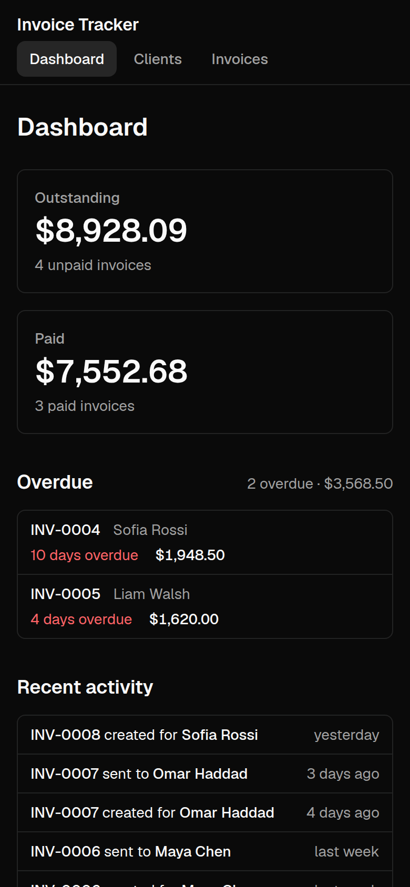

# Freelance Invoicing & Client Tracker

[](https://github.com/Rh96/freelance_invoicing_and_client_tracker/actions/workflows/ci.yml)

A web app for a solo freelancer: keep a client list, build invoices with line items and tax, and see at a glance who owes you money and who is late.

**Live demo:** <https://freelance-invoicing-and-client-trac.vercel.app/>


> **Try it.** The demo opens with fictional clients and invoices, saved in your browser only (nothing is sent anywhere). Change anything you like; **Reset demo data** in the footer restores the starting data. To see the error states, add `?simulateErrors=writes` (every save fails, so you can watch an optimistic update roll back) or `?simulateErrors=all` (every load fails) to the URL; `?simulateErrors=off` turns it off again.

## What it does

- **Clients:** list with search, create, edit, and archive (archived clients are hidden but keep their invoices).
- **Invoices:** line items with live totals, one tax rate, automatic numbering (`INV-0001`), and a Draft → Sent → Paid lifecycle; Paid can be undone. Only drafts can be edited. A print view saves a one-page PDF through the browser.
- **Dashboard:** outstanding versus paid totals, overdue invoices (most overdue first), and a recent activity feed.

|                                             Invoice form                                             |                                                  Invoice detail                                                  |
| :--------------------------------------------------------------------------------------------------: | :--------------------------------------------------------------------------------------------------------------: |
|  |  |
|                                            **Print view**                                            |                                               **Phone, dark mode**                                               |
|                                 |                               |

Out of scope for v1, on purpose: real authentication, payments, sending email, multiple currencies and recurring invoices. See [what comes next](#whats-next).

## What it demonstrates

| Area                       | How it's used here                                                                                                                                                                                           |
| -------------------------- | ------------------------------------------------------------------------------------------------------------------------------------------------------------------------------------------------------------ |
| Next.js App Router (16)    | Thin route files in [`src/app`](src/app), Cache Components (partial prerendering) with dynamic params read inside `<Suspense>`, route-level error boundaries, typed routes                                   |
| TypeScript (strict)        | `strict` plus `noUncheckedIndexedAccess`, no `any`; Zod schemas are the single source of the domain types ([`src/domain`](src/domain))                                                                       |
| TanStack Query             | Query-key factories, cache updates after saves, and **optimistic status changes with rollback** ([`invoices/mutations.ts`](src/features/invoices/mutations.ts))                                              |
| Zustand                    | UI state only: search, status filter, one-time messages ([`src/stores`](src/stores))                                                                                                                         |
| Forms and validation       | React Hook Form + Zod: a dynamic line-item array, live totals, cross-field date checks, errors from the data layer mapped back onto fields ([`invoice-form.tsx`](src/features/invoices/invoice-form.tsx))    |
| Tailwind and accessibility | Tailwind 4 + shadcn/ui (Radix), dark mode from the OS, print CSS; skip link, labelled fields, focus management, live regions, status shown as text and not only colour                                       |
| Testing                    | Vitest + React Testing Library against a real in-memory repository (no mocks of our own code); Playwright end-to-end tests, including axe accessibility scans and a keyboard-only walkthrough ([`e2e`](e2e)) |
| CI/CD                      | GitHub Actions runs lint, type check, unit tests and the production build, then the end-to-end suite against that build; Vercel deploys every PR as a preview and `main` to production                       |

## Key decisions

Each one is written up as an ADR in [`docs/DECISIONS.md`](docs/DECISIONS.md).

- **Browser storage behind a repository interface** ([ADR-002](docs/DECISIONS.md#adr-002-browser-storage-behind-a-repository-interface-for-v1)). Components never touch storage: they call an async [`Repository`](src/data/repository.ts) through TanStack Query. The localStorage version adds simulated latency (200–600 ms) and failure injection, so loading and error states are real, and stored data is validated with Zod on every read. A database version can replace it without changing a component ([see below](#whats-next)).
- **Money in integer cents** ([ADR-003](docs/DECISIONS.md#adr-003-money-as-integer-cents-one-tax-rate-round-once)). Prices are cents and tax is basis points; each line total is rounded once and tax is rounded once on the subtotal, so totals never show floating-point errors. All of it lives in one tested module, [`domain/money.ts`](src/domain/money.ts).
- **Each kind of state has one owner** ([ADR-004](docs/DECISIONS.md#adr-004-state-ownership-split)). Saved data lives in the Query cache, the form being edited in React Hook Form, and UI choices in Zustand. Nothing is copied between them.
- **Overdue and activity are derived, not stored** ([ADR-005](docs/DECISIONS.md#adr-005-overdue-and-activity-are-derived-not-stored)). "Overdue" is a Sent invoice past its due date, worked out from today's date on every render; the activity feed is built from the records' timestamps. Neither can go stale or disagree with the invoices.
- **Optimistic status changes** ([ADR-014](docs/DECISIONS.md#adr-014-optimistic-status-changes-with-one-shared-transition-rule)). "Mark as paid" updates the screen immediately. The cache and the repository apply the same transition function, so the prediction matches what gets saved, and a failed save rolls back with an explanation.

## Testing

- **307 unit and component tests** (Vitest + React Testing Library). Domain logic is pure functions; components render with a real repository over in-memory storage, with injected failures for the error states.
- **54 end-to-end tests** (Playwright, against the production build in Chrome):
  - the core flow: create a client → invoice → mark sent → mark paid → dashboard totals update;
  - a 15-line invoice prints on one page, in light and dark mode;
  - an optimistic update rolls back when the save fails;
  - **axe accessibility scans** of every route and of the empty, error, validation and dialog states, in light and dark mode (serious and critical problems fail CI);
  - a **keyboard-only** walkthrough of the core flow.

Writing the end-to-end and accessibility tests turned up **7 bugs that the component tests had missed**, all at the edges between the cache, the router, timing and the browser. For example, Next 16 keeps recently visited pages mounted but hidden, so after any in-page link focus fell to `<body>` and the next Tab jumped to the footer. Another: two quick status changes could reach storage in the wrong order. Each fix has a test that fails without it. The details are in the [learning log](docs/LEARNING_LOG.md).

## Run it locally

Requires Node 22+.

```bash
npm install
npm run dev        # http://localhost:3000
```

| Script                 | What it does                                                                   |
| ---------------------- | ------------------------------------------------------------------------------ |
| `npm run dev`          | Development server                                                             |
| `npm run build`        | Production build                                                               |
| `npm test`             | Unit and component tests (single run); `npm run test:watch` to watch           |
| `npm run e2e`          | End-to-end tests against the production build (run `npm run build` first)      |
| `npm run lint`         | ESLint                                                                         |
| `npm run typecheck`    | Generate Next route types, then `tsc`                                          |
| `npm run format:check` | Prettier check; `npm run format` to fix                                        |
| `npm run screenshots`  | Regenerate the README images in `docs/screenshots` (run `npm run build` first) |

The end-to-end tests use your installed Google Chrome, so there's no browser download.

## Project structure

```text
src/
  app/         routes only: pages, layouts, error and not-found screens
  features/    clients, invoices, dashboard: components, queries and mutations
  domain/      pure business rules: money, invoice status, dates, activity, schemas
  data/        the Repository interface, the localStorage version, demo seed
  stores/      Zustand UI state
  components/  app shell and shared UI (shadcn/ui in components/ui)
  config/      business settings: currency, invoice numbering, defaults
e2e/           Playwright tests
```

## What's next

The next step is a real database and sign-in. Because every read and write already goes through the `Repository` interface, that means a new implementation of it rather than changes across the app. [`docs/EXTENSIONS.md`](docs/EXTENSIONS.md) describes the plan: route handlers over Postgres, a `fetch`-based repository, per-user ownership, and importing a browser's demo data.

## Docs

[Product requirements](docs/PRD.md) · [Architecture](docs/ARCHITECTURE.md) · [App flow](docs/APP_FLOW.md) · [Decisions](docs/DECISIONS.md) · [Extensions](docs/EXTENSIONS.md) · [Tasks](docs/TASKS.md) · [Learning log](docs/LEARNING_LOG.md) · [Project board](https://github.com/users/Rh96/projects/4)
