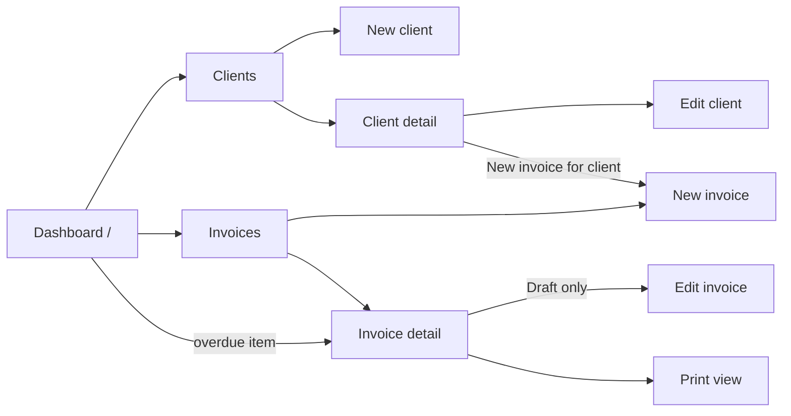
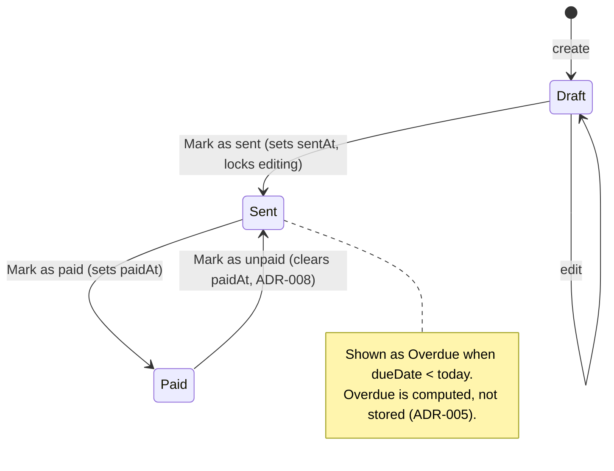
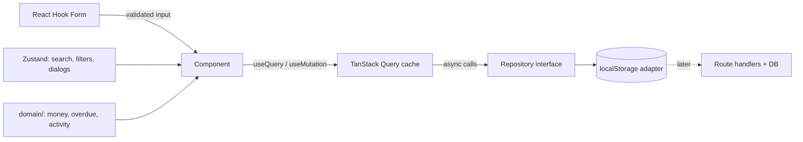

# App Flow — Freelance Invoicing & Client Tracker

**Last updated:** 2026-11-13

How the app is used and how data moves through it. Diagrams are Mermaid and render on GitHub.

## Screens and routes

| Route                  | Screen         | Purpose                                            |
| ---------------------- | -------------- | -------------------------------------------------- |
| `/`                    | Dashboard      | Outstanding vs paid, overdue list, recent activity |
| `/clients`             | Client list    | Search, list, archive toggle, "New client"         |
| `/clients/new`         | New client     | Client form                                        |
| `/clients/[id]`        | Client detail  | Details and that client's invoices                 |
| `/clients/[id]/edit`   | Edit client    | Client form, prefilled                             |
| `/invoices`            | Invoice list   | Status filter (Draft / Sent / Overdue / Paid)      |
| `/invoices/new`        | New invoice    | Invoice form with line items and live totals       |
| `/invoices/[id]`       | Invoice detail | Read-only view, status actions                     |
| `/invoices/[id]/edit`  | Edit invoice   | Draft only; Sent/Paid redirect to detail           |
| `/invoices/[id]/print` | Print view     | No app chrome; browser print / Save as PDF         |

## Navigation map

## Invoice status lifecycle

Paid → Sent exists only to undo a mistaken "Mark as paid". Sent never returns to Draft.

## Core flows

### 1. First visit

1. App loads → repository reads localStorage.
2. Nothing stored → write the demo seed. Stored data fails the Zod parse or version check → show "Data could not be loaded" with **Reset demo data**.
3. Dashboard renders from seeded data.

### 2. Create a client

1. Clients → **New client** → fill form (Zod validation on blur and submit).
2. Submit → `createClient` mutation (button pending) → invalidate `['clients']` → navigate to client detail with a success toast.
3. On failure: input is kept, error message shown, submit can be retried.

### 3. Create and send an invoice

1. **New invoice** (from Invoices, or from a client, which preselects them).
2. Pick client, dates, tax rate; add line items. Totals update live (`domain/money.ts`).
3. Save → status Draft, number assigned → invoice detail.
4. **Mark as sent** → `sentAt` set → invoice becomes read-only → **Print** → browser "Save as PDF" → freelancer emails it themselves.

### 4. Get paid

1. Dashboard overdue list or invoice list → invoice detail → **Mark as paid**.
2. Optimistic update: status shows Paid immediately; dashboard totals and activity reflect it after invalidation.
3. Save fails → roll back to Sent and show an error.

## Data flow

- **Reads:** component → query hook → repository (simulated latency) → Zod-parsed data → cache.
- **Writes:** form submit → mutation → repository → invalidate related keys (clients and invoices both feed the dashboard).
- **Derived:** totals, overdue and dashboard stats are computed from cached data on render; nothing derived is persisted.
